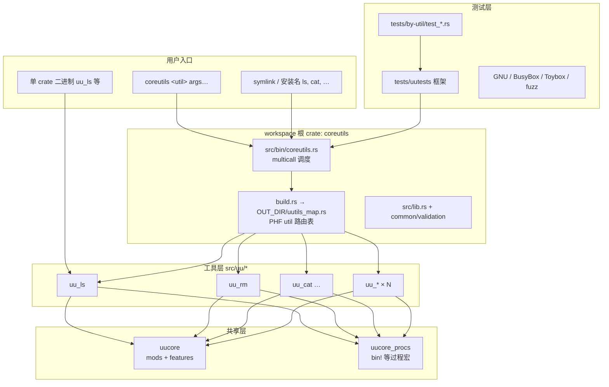
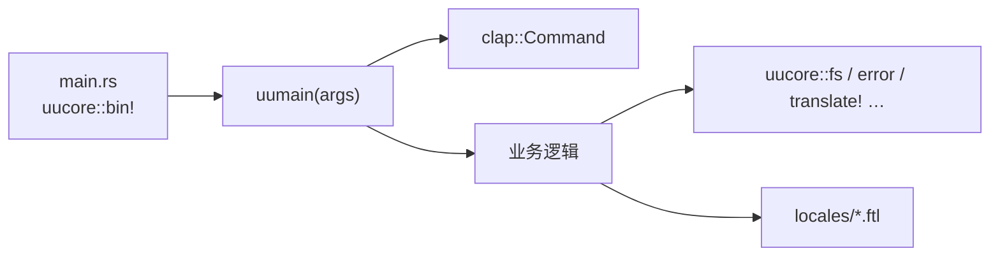
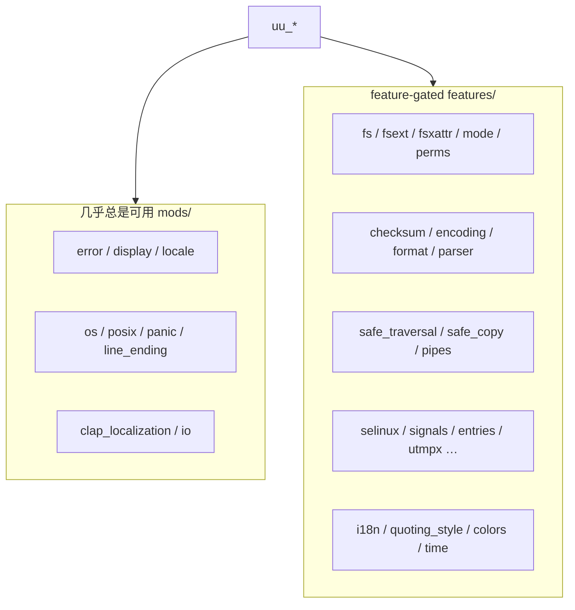
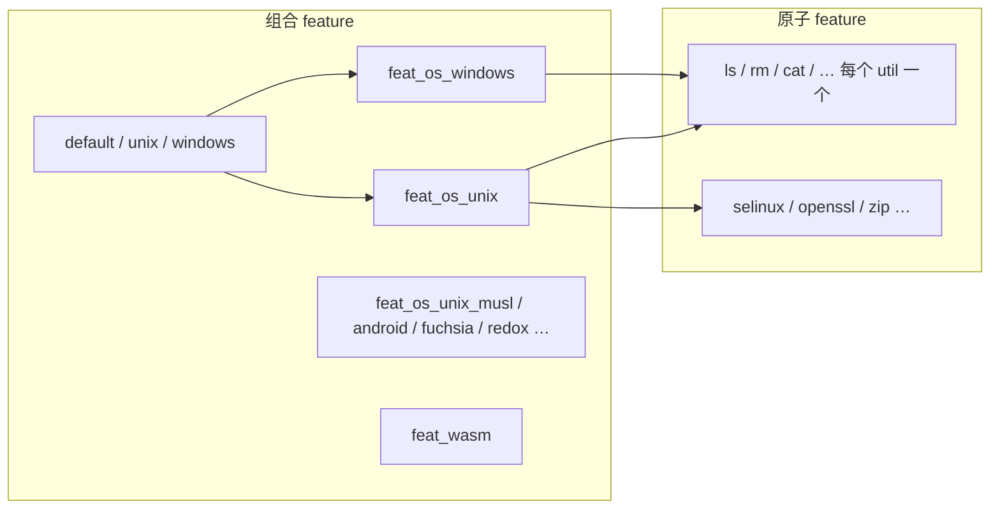
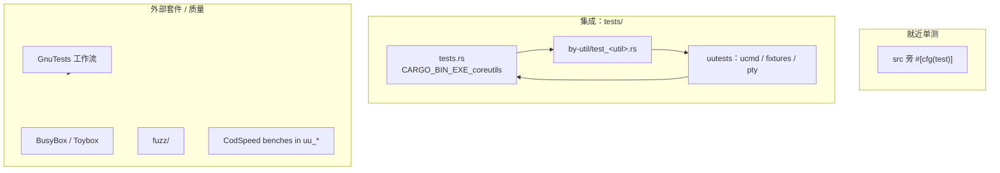
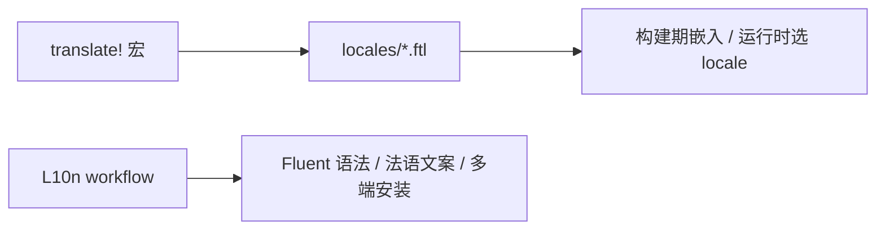
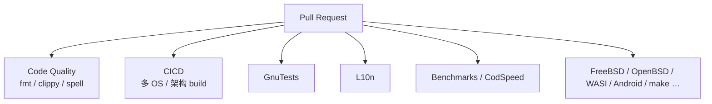
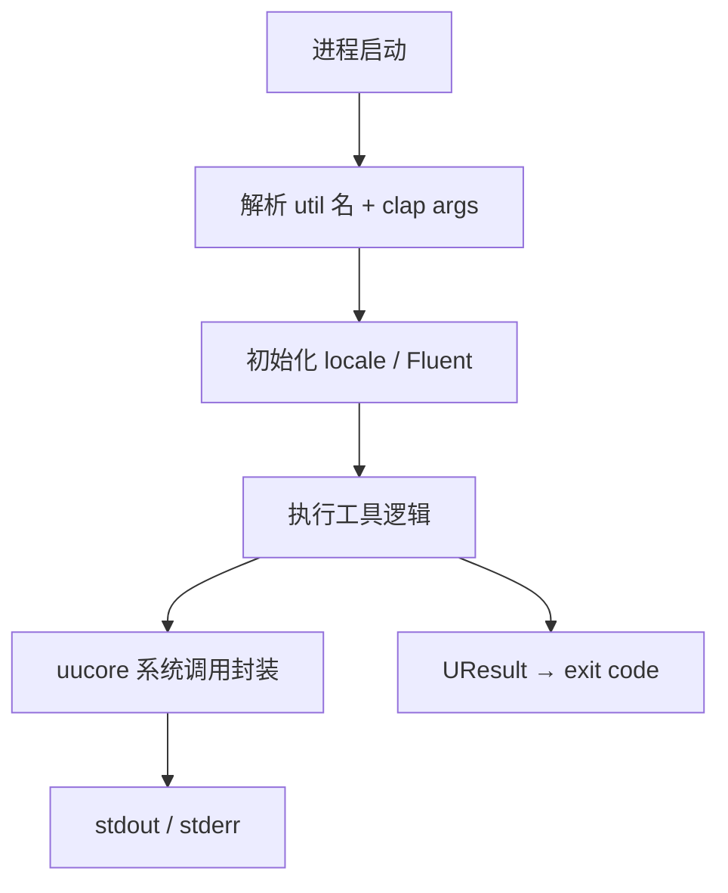

# uutils/coreutils 技术框架分析

> 个人笔记分支 `notes/tech-framework`，用于梳理本仓库的技术结构。  
> 基于上游 `main` 阅读源码归纳，**不是**官方文档；勿当作 GNU 行为规范。

## 1. 项目定位

| 项 | 说明 |
|----|------|
| 目标 | 用 Rust 实现跨平台、与 GNU coreutils **行为兼容** 的 CLI 工具集 |
| 许可 | MIT（**禁止**拷贝 GNU/GPL 源码） |
| 形态 | Cargo **workspace** + **multicall** 二进制 `coreutils` + 可选单工具安装 |
| 规模 | `src/uu/*` 约 100+ 个独立 util crate；共享库 `uucore` |

核心设计选择：

1. **一工具一 crate**（`uu_<name>`），便于按需编译与审查。
2. **共享能力进 `uucore`**，用 Cargo feature 按需开启，避免每个 util 重复造轮子。
3. **构建期生成 util 路由表**，一个 `coreutils` 二进制可调度所有已启用工具。
4. **平台/OS feature 矩阵**（`feat_os_unix` / `windows` / WASI 等）控制“能编什么”。

---

## 2. 总览架构图



---

## 3. 目录与 crate 职责

```text
coreutils/
├── Cargo.toml              # workspace + 根包 features（按 util / OS 组合）
├── build.rs                # 根据启用 feature 生成 uutils_map.rs
├── src/
│   ├── bin/coreutils.rs    # multicall 入口
│   ├── bin/uudoc.rs        # 文档生成辅助
│   ├── lib.rs / common/    # 校验二进制名、找不到 util 等
│   ├── uu/<name>/          # 单个工具 crate（uu_ls, uu_rm, …）
│   ├── uucore/             # 共享库（错误、locale、fs、checksum…）
│   └── uucore_procs/       # 过程宏（如 uucore::bin!）
├── tests/
│   ├── tests.rs            # 集成测试入口（按 feature 引入 by-util）
│   ├── by-util/test_*.rs   # 每工具行为测试
│   └── uutests/            # 测试 DSL（ucmd、pty、fixture）
├── docs/src/               # 官方手册（安装、平台、l10n、multicall…）
├── fuzz/                   # 模糊测试
└── .github/workflows/      # CI：CICD、Code Quality、GnuTests、Benchmarks…
```

### 3.1 各层功能说明

| 层 | 路径 | 功能 |
|----|------|------|
| Multicall | `src/bin/coreutils.rs` | 解析 argv0 / 第一参数 → 查表 → 调用对应 util 的 `uumain` |
| Util 路由 | `build.rs` → `uutils_map.rs` | 扫描 `CARGO_FEATURE_*`，生成 PHF 映射：`name → (uumain, clap Command)` |
| 单工具 | `src/uu/<name>/` | `main.rs` 通常一行 `uucore::bin!(uu_<name>)`；逻辑在 `src/<name>.rs` |
| 共享库 | `src/uucore/` | 跨工具 API：错误类型、`translate!`、fs/xattr、checksum、safe_traversal… |
| 过程宏 | `src/uucore_procs/` | 减少每个 util 的样板代码 |
| 测试 DSL | `tests/uutests/` | `new_ucmd!()`、`at_and_ucmd!()`、pty、管道、断言 stdout/stderr/exit |
| 本地化 | `**/locales/*.ftl` | Fluent 消息；CI 有 L10n 工作流 |

---

## 4. Multicall 与构建期路由

```mermaid
sequenceDiagram
  participant User
  participant CU as coreutils 二进制
  participant Map as util_map PHF
  participant Util as uu_&lt;name&gt;::uumain

  User->>CU: argv0=ls 或 coreutils ls …
  CU->>CU: validation::name(binary)
  alt argv0 以 util 名结尾（非 *utils）
    CU->>Map: 最长后缀匹配 util
  else multicall（coreutils / *box）
    CU->>CU: 取下一参数为 util 名
  end
  CU->>Map: 查 (uumain, make_app)
  Map->>Util: uumain(args)
  Util-->>User: exit code / stdout / stderr
```

要点：

- **启用哪些工具由 Cargo feature 决定**（例如 `ls` feature → 依赖 `uu_ls`）。
- OS 级集合如 `feat_os_unix` 一次打开“该平台常用工具包”。
- 未启用的 util **不会进路由表**，从而减小二进制与编译面。

官方说明见 `docs/src/multicall.md`。

---

## 5. 单个 util 的典型结构

以 `ls` 为例：

```text
src/uu/ls/
├── Cargo.toml          # 依赖 clap / uucore features / 平台 cfg
├── build.rs            # 可选：cfg_aliases（如 acl_platform）
├── locales/en-US.ftl   # 用户可见文案
└── src/
    ├── main.rs         # uucore::bin!(uu_ls)
    ├── ls.rs           # uumain + 业务
    ├── display.rs …
    └── colors.rs …
```



约定：

- 入口函数名一般为 **`uumain`**，返回可转为进程退出码的结果（经 `uucore` 错误体系）。
- 用户可见字符串走 **Fluent**（`translate!`），避免硬编码多语言。
- 平台差异用 `#[cfg]` / `cfg_aliases`，并保证 CI 各 target 能编过。

---

## 6. `uucore`：共享能力怎么拆



| 类别 | 示例模块 | 用途 |
|------|----------|------|
| 错误与退出 | `error` | `UResult`、`USimpleError`、统一 exit |
| 文案 | `locale` + Fluent | `translate!` |
| 文件系统 | `fs`, `fsext`, `fsxattr`, `safe_traversal` | 元数据、扩展属性、安全遍历 |
| 解析 | `parser`（size/time/glob/num） | 与 GNU 相近的参数/尺寸解析 |
| 校验和 | `checksum` | `cksum` / `*sum` / `hashsum` 共用 |
| 安全相关 | `selinux`, `perms`, `mode` | 标签、权限位 |
| 终端 | `tty`, 配合 crossterm（各 util） | 交互式工具 |

util 的 `Cargo.toml` 只打开自己需要的 `uucore` features，避免无用依赖膨胀。

---

## 7. Feature 与平台矩阵



含义简述：

- **原子 feature**：启用对应 `uu_*` 依赖，并进入 multicall 表。
- **`feat_os_*`**：面向某一类目标 OS 的推荐工具集合（CI 用同名集合编测）。
- 特殊工具（如 SELinux 的 `chcon`/`runcon`）还会在 `build.rs` 里按 `target_os` 过滤。

平台细节见官方 `docs/src/platforms.md`。

---

## 8. 测试框架



| 机制 | 说明 |
|------|------|
| Feature 门控 | `tests.rs` 里 `#[cfg(feature = "ls")]` 才编译 `test_ls` |
| uutests | 统一起 `coreutils` multicall，设置 `UUTESTS_BINARY_PATH` |
| 行为断言 | `.succeeds()` / `.fails_with_code(n)` / `.stdout_is` / `.stderr_contains` |
| 回归要求 | 新行为或修 bug 需带 Rust 测试（见 `AGENTS.md` / `CONTRIBUTING.md`） |

---

## 9. 本地化（l10n）



- 每个 util（及 uucore 公共串）可有 `locales/en-US.ftl` 等。
- clap 错误也可走本地化路径（`clap_localization`）。
- 详见 `docs/src/l10n.md`。

---

## 10. CI / 质量门禁（结构视角）



与框架相关的约束：

- **clippy `-D warnings`**、**rustfmt** 为合并硬门槛之一。
- 改 `uucore` / `Cargo.lock` 时 Benchmarks 可能跑**全部**有 bench 的 util（噪声来源之一）。
- 跨平台：`cfg` 变更要想到 macOS / Windows / WASI 的 compile 面。

---

## 11. 一次典型调用的数据流（逻辑）



错误路径强调：

- 业务错误走 `uucore::error`，避免直接 `process::exit` / 随意 `unwrap`（见 uutils Review Guidelines）。
- 交互式工具（如 `more`）另接终端库（crossterm），仍通过统一 exit 习惯收尾。

---

## 12. 与官方文档的对应关系

| 想了解… | 优先读 |
|---------|--------|
| 怎么编、怎么测 | `DEVELOPMENT.md` |
| 贡献 / 许可 / 禁止 GNU 源码 | `CONTRIBUTING.md`, `AGENTS.md` |
| Multicall 用法 | `docs/src/multicall.md` |
| 平台矩阵 | `docs/src/platforms.md` |
| 本地化 | `docs/src/l10n.md` |
| 性能 | `docs/src/performance.md` |
| uucore API | <https://docs.rs/uucore> |

本笔记侧重**结构关系与职责划分**；具体工具语义以 issue / 测试 / 手册为准。

---

## 13. 小结

uutils/coreutils 的技术骨架可以概括为：

1. **Workspace 拆分**：根 multicall + 大量 `uu_*` + `uucore`。  
2. **编译期可裁剪**：Cargo feature ↔ 工具集合 ↔ PHF 路由表。  
3. **运行时薄调度**：`coreutils` 只负责选 util；行为在各 crate。  
4. **共享下沉**：可复用逻辑进 `uucore`，用 feature 隔离。  
5. **测试同构**：uutests 驱动同一 multicall 二进制，保证“装包形态 ≈ 测包形态”。

---

*生成用途：个人远程分支存档。更新时请 rebase/merge 最新 `upstream/main` 后修订本目录。*
